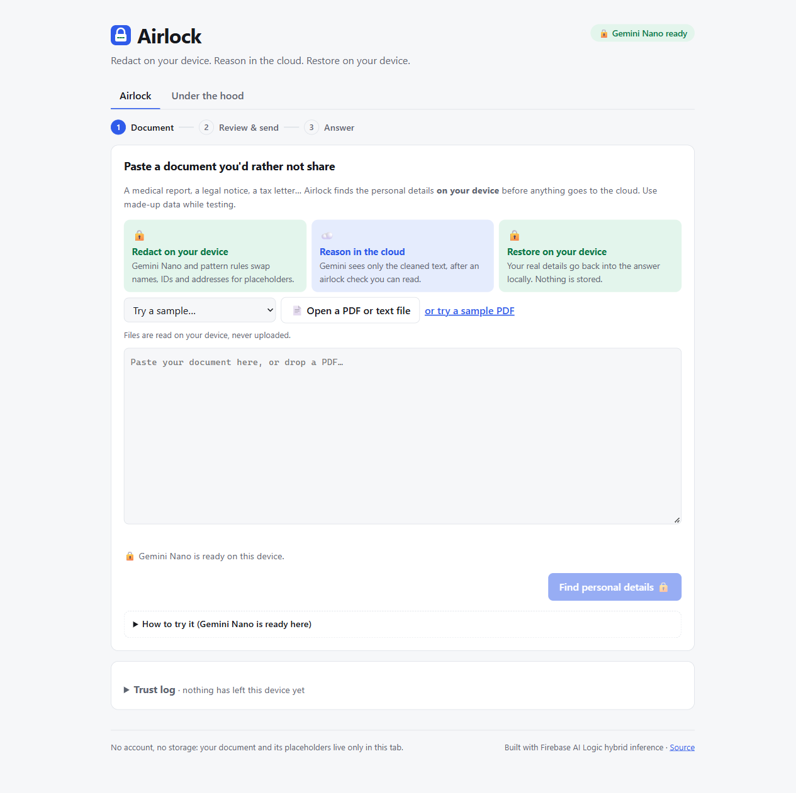
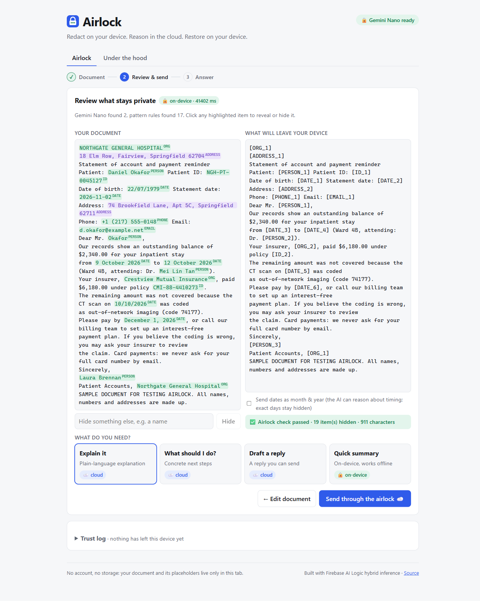
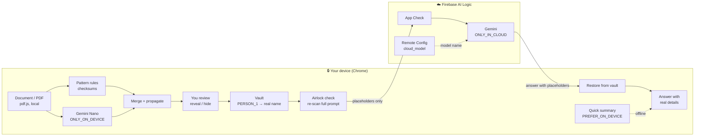

# Airlock

**Redact on your device. Reason in the cloud. Restore on your device.**

Airlock lets you get AI help with sensitive documents, like a hospital bill, a legal notice or a tax letter, without handing over your identity.

- Gemini Nano finds the personal details **on your device**, and deterministic pattern rules back it up.
- Those details are swapped for placeholders like `[PERSON_1]`.
- Only that cleaned text goes to Gemini **in the cloud**, which does the reasoning.
- The answer comes back with your real details put back in, **on your device**.

The split between device and cloud isn't a fallback: **it is the privacy feature.**

Built for [#BuildHybridAI 2026](https://firebasehybridaihackathon.devpost.com/) with the **Firebase AI Logic hybrid inference SDK** (`firebase/ai`).

| Paste or open a PDF | Review what leaves the device |
|---|---|
|  |  |

---

## Why

People already paste medical reports, eviction notices and tax letters into chatbots, because the documents are confusing and the stakes are high. Doing that hands a cloud service their name, date of birth, address, patient ID and policy numbers.

Airlock keeps the identity on the device and sends only the *problem* to the cloud.

## What it does

1. **Document:** paste text, pick a synthetic sample, or open a PDF. The PDF is parsed in the browser with pdf.js and is never uploaded.
2. **Detect, on-device:** two detectors run together.
   - **Gemini Nano** extracts names, addresses, organisations and IDs, as constrained JSON.
   - **Pattern rules** catch emails, phone numbers, card numbers (Luhn-checked), IBANs (mod-97), SSNs, Aadhaar numbers (Verhoeff), PAN, dates, reference codes, names after titles, labels and sign-offs, and company names.
3. **Review:** every item is highlighted, and you can click one to reveal or hide it, or hide any phrase yourself.
   - Next to your document you see **exactly what will leave your device**.
   - An optional switch sends dates as month and year only.
4. **Airlock check:** the full outgoing prompt is re-scanned on the device. If anything hidden or pattern-detectable is still in it, **the send button stays locked**.
5. **Reason, in the cloud:** Gemini explains the document, lists next steps, or drafts a reply, using only the placeholders.
6. **Restore, on-device:** the placeholders are swapped back with plain text replacement from a local vault, so nothing is invented. A toggle shows what the cloud actually saw.
7. **Trust log:** a list of every request that left the device, showing the exact text sent. It is kept in memory only.

**Hybrid by design:**
- **Quick summary** runs on Gemini Nano (`PREFER_ON_DEVICE`) and works **offline**.
- Without Nano, Airlock runs in **safe mode**: pattern rules only, a clear warning, and an explicit consent checkbox before sending.

## How the hybrid routing works

Every model call picks its route explicitly in [src/ai/models.ts](src/ai/models.ts). The badges in the UI come from the SDK's real `response.inferenceSource`, not from assumptions.

| Step | Inference mode | Why |
|---|---|---|
| Detect personal data | `ONLY_ON_DEVICE` | Raw text must never leave the device. The SDK throws rather than falling back to the cloud |
| Explain / next steps / draft a reply | `ONLY_IN_CLOUD` | Needs a large model. Only ever receives placeholders |
| Quick summary | `PREFER_ON_DEVICE` | Works offline. Uses the cloud only if Nano is missing, and even then only with redacted text |
| Airlock check, restore | No model | Deterministic code, so it can't hallucinate |



## Detection quality

A set of **20 synthetic documents** (medical, legal, tax, HR, housing, insurance) with hand-labelled personal data lives in [src/eval/dataset.ts](src/eval/dataset.ts). It is scored in unit tests and in the app ("Under the hood" → Detection score), with real Gemini Nano.

| Detector | Recall | Precision |
|---|---|---|
| Pattern rules only (safe mode) | 82.7% | 100% |
| Pattern rules + Gemini Nano | **99–100%** across 3 runs | 97–98% |

- **Recall** means that 90% or more of a labelled item's characters are hidden.
- **Precision** is the share of hidden items that really were personal data.
- The only "false" hits are public bodies such as the IRS and HM Revenue & Customs, which are harmless to hide.

**Lesson learned:** Nano's misses change from run to run, so every item type that can have a deterministic backstop has one. Anything found once is hidden at every other occurrence, and a surname mentioned alone reuses the full name's placeholder.

## Try it

**Live demo:** _link added after deploy_

- **With Gemini Nano (full hybrid):** use desktop Chrome.
  1. Open `chrome://flags/#prompt-api-for-gemini-nano`, set it to **Enabled**, and restart Chrome.
  2. Open Airlock and click into the document box. Nano downloads once (a few GB).
  3. The header shows **🔒 Gemini Nano ready**.
- **Without Nano:** any modern browser works in safe mode. Pattern rules hide what they can, you add anything they missed, and you confirm before sending.

Then:
1. Pick a sample from **Try a sample…**, or click **or try a sample PDF**.
2. Press **Find personal details**, review the two columns, and choose **Explain it**.
3. Open the **Trust log** at the bottom to see exactly what the cloud received.

All samples are made up. **Please use made-up data when testing.**

## Run it locally

Requirements: Node 20+, a Firebase project, and desktop Chrome for Gemini Nano.

1. **Firebase project:** in the [Firebase console](https://console.firebase.google.com/), create a project, open **AI Logic**, and enable the **Gemini Developer API**. Register a **Web app**.
2. **App Check:** register the web app with **reCAPTCHA Enterprise**. For local development, use a debug token:
   - set `VITE_APPCHECK_DEBUG_TOKEN=true`
   - open the app once and copy the token from the browser console
   - add it under **App Check → Apps → Manage debug tokens**
3. **Config:**
   ```sh
   cp .env.example .env.local   # then fill in the values from your web app config
   npm install
   npm run dev
   ```
4. **Tests:** `npm test` runs the unit tests, covering detection, the vault, the airlock check, the PDF text joining and the evaluation set.

**Optional: Remote Config.** Add a string parameter `cloud_model`, for example `gemini-3.8-flash`, to switch the cloud model without a redeploy. Without it, `VITE_CLOUD_MODEL` is used. "Under the hood" shows which one is active.

### Deploy to Firebase Hosting

```sh
npx firebase login
npx firebase use --add          # pick your project
npm run deploy                  # builds, then deploys dist/ to Hosting
```

**For production App Check:**
1. Add your Hosting domains to the reCAPTCHA Enterprise key: `<project>.web.app` and `<project>.firebaseapp.com`.
2. Put the site key in `VITE_RECAPTCHA_ENTERPRISE_SITE_KEY`.
3. Remove `VITE_APPCHECK_DEBUG_TOKEN` from the build environment. The debug token is only ever used in `npm run dev`.
4. **Enforce** App Check for AI Logic in the console.

## Privacy and security notes

- **No backend, no accounts, no storage.** The document, the vault and the trust log live only in the open tab's memory.
- **The airlock check runs on the full prompt**, not just the document, and blocks sending if a hidden value reappears anywhere.
- **The cloud prompt fences the document as data** and tells the model to ignore instructions inside it. It also tells the model never to guess what's behind a placeholder. Placeholders the model invents are flagged and left as they are.
- **The answer is rendered by a small Markdown parser into React elements.** There is no `innerHTML` anywhere.
- **Hosting sends security headers:** `nosniff`, `no-referrer`, `DENY` framing and a restrictive `Permissions-Policy`.

## Known limitations

- **Indirect identifiers** can't be fully removed by any redactor: a rare diagnosis plus a town plus a date might still point to someone. Airlock shows you exactly what is sent, and offers to blur dates to month and year.
- **Detection is very good but not perfect.** The review step exists for that reason, and safe mode is honest that names and addresses may slip through.
- **PDFs need selectable text.** Scanned images aren't OCR'd.
- **Gemini Nano** needs desktop Chrome with enough disk space and memory, and the first download takes a while.
- **Answers are general information,** not legal, medical or financial advice.

## Project layout

```
src/
  ai/          models.ts (hybrid routing), nano.ts (availability), nanoPrompt.ts
  redact/      patterns.ts, nano.ts (Nano extraction), merge.ts, detect.ts, vault.ts, dates.ts
  flow/        AirlockFlow.tsx (the 3 steps), tasks.ts (prompts), logic.ts, TrustLog.tsx, markdown.ts
  input/       readFile.ts (PDF/text, on-device)
  components/  Lab.tsx ("Under the hood"), EvalPanel.tsx, Highlighted.tsx, HowItWorks.tsx
  eval/        dataset.ts (20 synthetic docs), score.ts
```

## License

[Apache 2.0](LICENSE)
